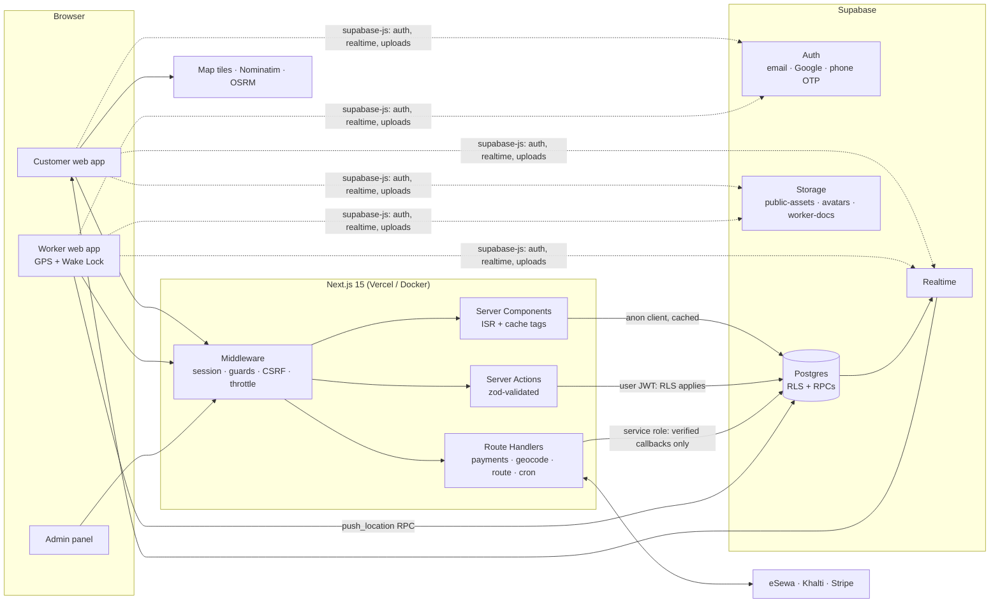
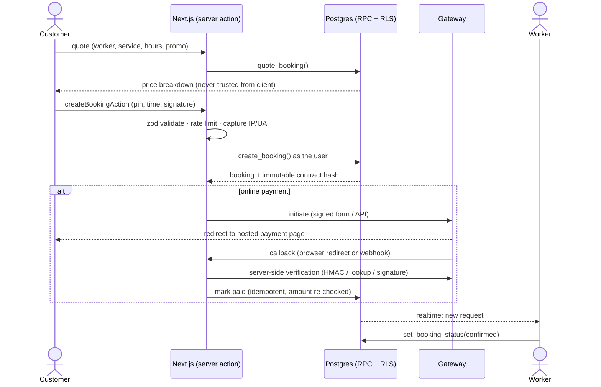
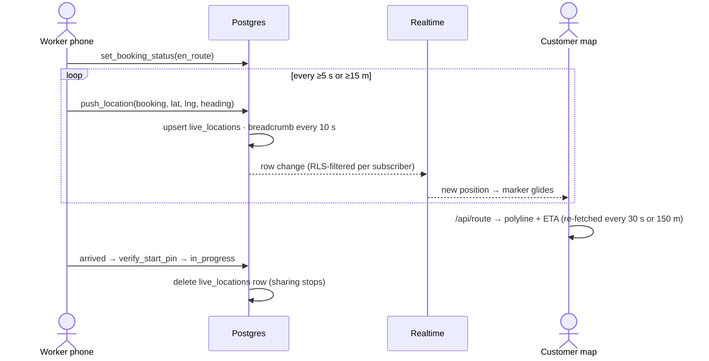
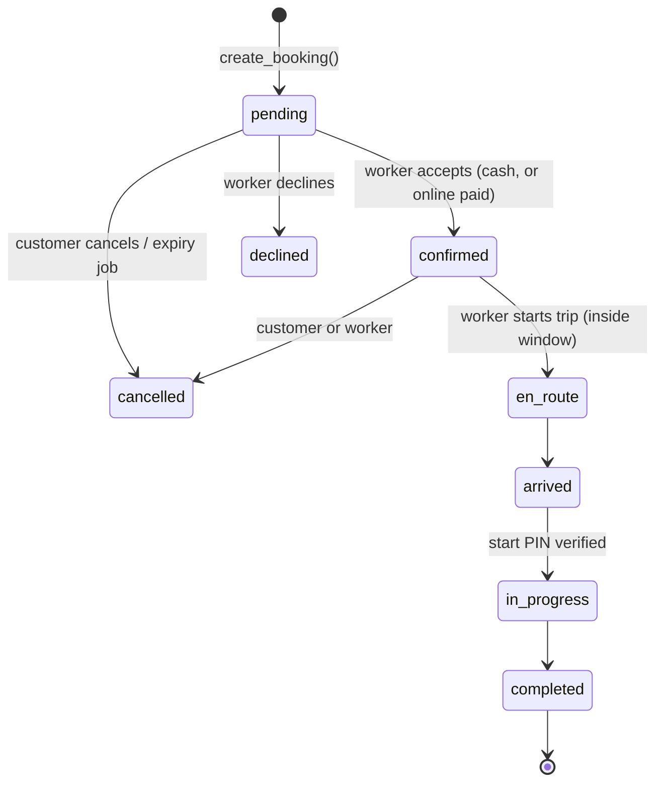
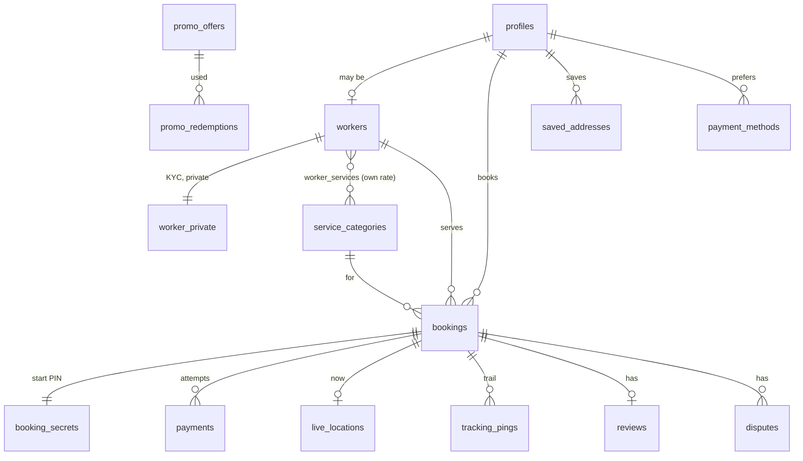

# Architecture

## 1. System at a glance

**Three database clients, three trust levels**

| Client | Used by | Power |
|---|---|---|
| `createPublicClient()` (anon, no cookies) | cached public reads (services, config, workers) | RLS "public" policies only |
| `createClient()` (user session cookie) | server components, server actions | exactly what the signed-in user may do |
| `createAdminClient()` (service role, `server-only`) | payment callbacks, enquiry intake, cron, rate limiter | bypasses RLS: never reachable from the browser; callers authenticate first |

## 2. Where the business rules live

Everything that must not be tampered with runs **inside Postgres** (`supabase/migrations/0002_functions.sql`), so a modified browser or a direct API call cannot cheat:

| RPC / trigger | Guarantees |
|---|---|
| `create_booking()` | caller is active · worker approved & offers the service · notice period · ≤ N days ahead · worker's days/hours (Nepal time) · pin inside an active service area (haversine) · enabled payment method · **price, promo, VAT, commission computed in SQL** · contract rendered from the active template and **SHA-256 hashed** · random start PIN stored apart · **no overlapping bookings per worker** (GiST exclusion constraint) |
| `set_booking_status()` | strict state machine with role checks; online payments must be paid before acceptance; travel only inside the tracking window; job start needs a verified PIN; cash marked paid on completion; location row deleted when travel ends |
| `verify_start_pin()` | 5 attempts then lock; failures are *committed* (returns, not raises) so brute force cannot be rolled back |
| `push_location()` | only the assigned worker, only in `en_route`/`arrived`, 2 s server throttle, breadcrumb every 10 s or 25 m |
| `get_booking_contacts()` | phone numbers revealed only to the counterpart, only while a booking is active |
| `protect_*` triggers | role, status, rating, commission can't be self-edited even though RLS allows row updates |
| `admin_dashboard()` | one-round-trip analytics, admin-only |

## 3. Booking flow

## 4. Live tracking

Only the booking's customer, its worker and admins can read a `live_locations` row (RLS). Realtime respects those policies. A 10 s poll covers dropped websockets.

## 5. Booking state machine

## 6. Data model (condensed)

CMS tables: `site_settings` (one JSON row per group), `service_categories`, `service_areas`, `promo_offers`, `contract_templates`, `faqs`, `testimonials`, `pages`. Support: `enquiries`, `notifications`, `audit_logs`, `rate_limits`.

## 7. Dynamic CMS: how "no redeploy" works

1. **Config rows** (`site_settings`) hold brand, theme, hero, announcement, contact, SEO, booking rules, payment switches, feature flags, home layout and UI-string overrides.
2. `getSiteConfig()` reads them through `unstable_cache` with tag `site-config` (+ defaults merged underneath, so a missing row never breaks the page).
3. **Theme**: `<ThemeStyle/>` turns palettes into CSS variables (`--c-bg: 17 18 22`). Tailwind colours are `rgb(var(--c-…) / <alpha>)`, so the *whole UI* re-colours from data. Values are validated as `#RRGGBB` before they reach a `<style>` tag (no CSS injection). Dark and light palettes are independent; the visitor's toggle is remembered.
4. **Copy**: every string is `{en, ne}` in `COPY_DEFAULTS`, overridable per key. `<Bi>` renders both languages and CSS (`html[data-lang]`) shows the active one, so pages stay fully static and the language switch is instant.
5. **Layout**: `home_layout.sections` is an ordered list the home page maps to components.
6. **Entities** (services, offers, FAQ, pages, agreement, areas) are described once in `src/lib/admin/resources.ts` (fields, columns, validation, cache tags). The same definition drives the admin form, the list table and the server action; adding an editable table = one entry.
7. **Save path**: admin form → server action → `adminCtx()` (verified admin) → validated write through the user's session (RLS admin policy is the second lock) → `audit_logs` row → `revalidateTag()` → visitors see it in ~1 s.

## 8. State management

| Kind | Where | Why |
|---|---|---|
| Server data | React Server Components + cache tags | no client fetch waterfalls, cacheable, SEO |
| Mutations | Server Actions returning `ActionResult` | validated on the server, progressive enhancement |
| Wizard draft | `useReducer` + `sessionStorage` | survives refresh / login detour; cleared on success |
| Realtime | Supabase channel inside `LiveTrackingMap` / `LiveRefresh` (+ polling) | scoped per booking; cleaned up on unmount |
| UI language / theme | `localStorage` + `data-*` attributes, set before first paint | no flash, no server cookie, pages stay cacheable |
| Auth in header | browser client | keeps public pages static |

## 9. Scalability plan

* **Traffic surge on public pages**: `/`, `/services`, `/p/*` are static with ISR; the CDN serves them, Supabase is hit only at revalidation (≈ 1 query burst per few minutes). `/api/workers` is `s-maxage=30` cacheable.
* **Database load**: hot reads are indexed (`bookings(customer_id, scheduled_start)`, `bookings(worker_id, …)`, `workers(status, is_listed, rating_avg)`); analytics are one SQL call, admin only. The booking path is one RPC (one round trip, one transaction).
* **Connections**: supabase-js talks to PostgREST, which pools connections. If you add direct Postgres access (Prisma/Drizzle, workers) use the **Supavisor transaction pooler** (port 6543) and `pgbouncer=true`.
* **Realtime fan-out**: one `live_locations` row per active booking, filtered by `booking_id`, so a message goes to one or two subscribers, not everyone. Breadcrumbs are sampled (10 s / 25 m) and purged after 14 days. At very high volume, partition `tracking_pings` by month and move live positions to Realtime *Broadcast*.
* **Rate limiting**: edge-level burst throttle in middleware, per-user/per-IP limits in handlers (Upstash Redis if configured, else Postgres, else memory).
* **Maps**: tiles, geocoding and routing are the first external limits. Swap the demo endpoints for a paid tile provider and a self-hosted/commercial Nominatim + OSRM before launch campaigns.
* **Scaling Supabase**: upgrade compute add-on, read replicas for analytics, PITR backups. Next.js scales horizontally (stateless; standalone Docker image).
* **Failure modes**: config/DB outage → built-in defaults keep the public site up; limiter outage fails open; payment callbacks are idempotent so retries are safe.

## 10. Extending

* **New gateway** (Fonepay, IME Pay…): add `src/lib/payments/<name>.ts` (`start` + `verify`), a callback route under `src/app/api/payments/<name>/`, add the provider to the `payment_provider` enum and the payments toggle.
* **New language**: add a column pair / copy entry, extend `Bi`, add a toggle value.
* **New service type**: Admin → Services (no code).
* **Native app**: reuse the same Supabase project, RPCs and RLS; build Worker + Customer apps with Expo/Capacitor; background location posts to `push_location`.
